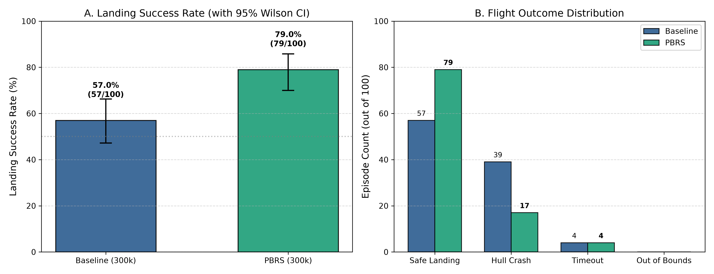
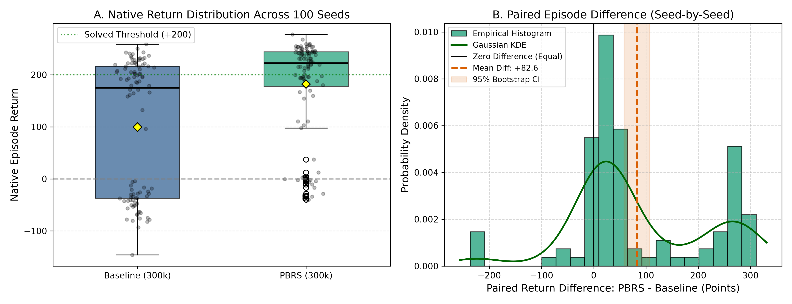
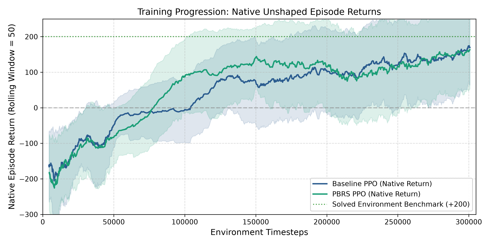

# LunarLander-v3: Potential-Based Reward Shaping (PBRS) Benchmark

A reproducible study comparing baseline Proximal Policy Optimization (PPO) against Potential-Based Reward Shaping (PBRS) on the Gymnasium `LunarLander-v3` environment using Stable-Baselines3.

---

## 1. Project Overview & Motivation

In reinforcement learning, designing reward signals that accelerate learning without inducing unintended agent behaviors is a central challenge. 

### Does `LunarLander-v3` Have Sparse or Dense Rewards?
`LunarLander-v3` is **already a dense-reward environment**. At every simulation step, the environment provides continuous feedback based on:
* Distance to the landing pad $(0, 0)$
* Linear velocity components $(v_x, v_y)$
* Lander body tilt angle $\theta$
* Ground contact flags for both landing legs
* Fuel expenditure penalties for firing engines

### The Core Problem: The Delayed Terminal Crash Cliff
Despite dense positional guidance, standard agents frequently struggle with the **terminal landing phase**:
* Catastrophic structural collisions carry a sharp $-100$ penalty delivered only at the final moment of impact.
* The native dense shaping does not sufficiently penalize rapid downward descent near the ground or severe body tilt before touchdown.
* As a result, standard PPO agents often descend too fast to arrest vertical velocity in the final meters, resulting in high crash rates (39.0% for the 300,000-timestep baseline).

### Why Potential-Based Reward Shaping (PBRS)?
Ad-hoc heuristic reward shaping—such as adding arbitrary step-by-step penalties for velocity or tilt—often alters the Markov Decision Process (MDP), leading to **reward hacking** (e.g., an agent learning to hover indefinitely to accumulate positive rewards, or intentionally crashing early to truncate cumulative penalties).

**Potential-Based Reward Shaping** ([Ng et al., 1999](https://people.eecs.berkeley.edu/~pabbeel/cs287-fa09/readings/NgHaradaRussell-shaping-ICML1999.pdf)) adds an auxiliary reward $F(s, s')$ to the existing environment reward:

$$R_{\text{shaped}}(s, a, s') = R_{\text{native}}(s, a, s') + F(s, s')$$

$$F(s, s') = \gamma \Phi(s') - \Phi(s)$$

where:
1. **Discount Factor Consistency**: $\gamma$ strictly matches the agent's discount factor (here, $\gamma = 0.99$).
2. **Absorbing Terminal Boundary Condition**: Any terminal absorbing state satisfies $\Phi(s_{\text{terminal}}) \equiv 0$.
3. **Stationary State Potential**: $\Phi(s)$ is a continuous potential function that depends strictly on state $s$ (not actions $a$ or time $t$).

Under these three conditions, the intermediate shaping terms form a **telescoping sum** across trajectories:

$$\sum_{t=0}^{T-1} \gamma^t F(s_t, s_{t+1}) = \gamma^T \Phi(s_T) - \Phi(s_0) = -\Phi(s_0)$$

Because this sum depends only on the start and end states, PBRS mathematically guarantees **policy invariance**: the optimal policy $\pi^*$ under $R_{\text{shaped}}$ is identical to the optimal policy under $R_{\text{native}}$.

> **Important Theoretical Disclaimer**:
> Policy invariance guarantees that the asymptotic set of optimal policies $\pi^*$ in the underlying MDP remains unchanged. It does **not** guarantee faster training convergence, reduced sample complexity, or superior neural network optimization under finite gradient descent updates. In practice, a poorly calibrated potential function could distort value function landscapes or increase policy gradient variance. The empirical gains observed below stem from a carefully calibrated physical potential, not an automatic guarantee of the mathematical theorem.

---

## 2. Environment & RL Setup

* **Environment**: `LunarLander-v3` (Gymnasium Box2D continuous physics simulation)
  * **State Space** (8 continuous dimensions):
    * $x, y$: Horizontal and vertical coordinates (target landing pad centered at $(0, 0)$)
    * $v_x, v_y$: Linear horizontal and vertical velocities
    * $\theta, \omega$: Body angle (radians) and angular velocity
    * $\text{leg}_1, \text{leg}_2$: Ground contact flags for left and right landing gear
  * **Action Space** (4 discrete actions):
    * `0`: Do nothing (engines idle)
    * `1`: Fire left orientation thruster (pushes right / clockwise torque)
    * `2`: Fire main engine (upward thrust)
    * `3`: Fire right orientation thruster (pushes left / counter-clockwise torque)
* **Algorithm**: Proximal Policy Optimization (PPO) via [Stable-Baselines3](https://github.com/DLR-RM/stable-baselines3)
  * Policy Network: Two-layer MLP (`MlpPolicy`, $64 \times 64$ hidden units, Tanh activations)
  * Training Budget: 300,000 environment timesteps
  * Hyperparameters: Learning rate $3 \times 10^{-4}$, rollout steps $n_{\text{steps}} = 2048$, minibatch size $64$, epochs per update $10$, $\gamma = 0.99$, GAE $\lambda = 0.95$, clip range $\epsilon = 0.2$, entropy coefficient $0.01$, value coefficient $0.5$, max gradient norm $0.5$.

---

## 3. Potential Function Formulation

The potential function $\Phi(s)$ provides continuous guidance on vertical descent braking, body uprightness, angular stabilization, and pad centering:

$$\Phi(s) = - \Big[ W_{\text{descent}} \cdot \text{penalty}_{\text{descent}} + W_{\text{tilt}} \cdot \text{penalty}_{\text{tilt}} + W_{\text{spin}} \cdot \text{penalty}_{\text{spin}} + W_{\text{center}} \cdot \text{penalty}_{\text{center}} \Big]$$

### Component Penalties
1. **Descent Rate Penalty**:
   $$\text{penalty}_{\text{descent}} = \left(1.0 - \frac{\text{clip}(y, 0.0, 1.5)}{1.5}\right) \cdot \frac{\text{clip}(\max(0.0, -v_y), 0.0, 2.0)}{2.0} \in [0.0, 1.0]$$
   * **Directional**: Only downward descent ($-v_y > 0$) is penalized. Upward arrest ($v_y > 0$) receives zero penalty.
   * **Altitude-Damped**: Multiplied by ground proximity $(1 - y_{\text{norm}})$. At high altitude ($y \ge 1.5$), penalty is zero; near the surface ($y \le 0.0$), the penalty scales to maximum.
   * **Numerically Stable**: No division by altitude, eliminating division-by-zero risks.
2. **Body Tilt Penalty**:
   $$\text{penalty}_{\text{tilt}} = \frac{\text{clip}(|\theta|, 0.0, \pi)}{\pi} \in [0.0, 1.0]$$
3. **Spin Rate Penalty**:
   $$\text{penalty}_{\text{spin}} = \frac{\text{clip}(|\omega|, 0.0, 3.0)}{3.0} \in [0.0, 1.0]$$
4. **Horizontal Centering Penalty**:
   $$\text{penalty}_{\text{center}} = 0.5 \cdot \text{clip}(|x|, 0.0, 1.0) + 0.5 \cdot \frac{\text{clip}(|v_x|, 0.0, 2.0)}{2.0} \in [0.0, 1.0]$$

### Scaling and Boundary Conditions
* Weights: $W_{\text{descent}} = 4.0, W_{\text{tilt}} = 3.0, W_{\text{spin}} = 1.0, W_{\text{center}} = 2.0$.
* **Universal Boundedness**: $\Phi(s) \in [-10.0, 0.0]$ for all possible inputs $s \in \mathbb{R}^8$.
* **Terminal States**: $\Phi(s_{\text{terminal}}) \equiv 0.0$ upon physical episode termination (safe rest or crash).
* **Truncations**: Time-limit truncations (1,000 steps) evaluate physical $\Phi(s)$ to prevent artificial boundary bonuses.

---

## 4. Experimental Results (100 Matched Evaluation Seeds)

Both models were trained for 300,000 timesteps using training `seed 42` and evaluated deterministically over **100 identical evaluation seeds (seeds 1000–1099)** on the **raw, unshaped environment**:

| Metric | Baseline PPO (300k) | PBRS PPO (300k) | Change (PBRS vs. Baseline) |
| :--- | :---: | :---: | :---: |
| **Landing Success Rate** | **57.0%** (57/100) | **79.0%** (79/100) | **+22.0% absolute** (+38.6% relative) |
| **Hull Crash Rate** | **39.0%** (39/100) | **17.0%** (17/100) | **-22.0% absolute** (-56.4% reduction) |
| **Timeout Rate (1,000 steps)**| 4.0% (4/100) | 4.0% (4/100) | Identical (no hover trapping) |
| **Out-of-Bounds Rate** | 0.0% (0/100) | 0.0% (0/100) | Identical (zero lateral exits) |
| **Ambiguous Outcomes** | 0.0% (0/100) | 0.0% (0/100) | 100% cleanly classified |
| **Mean Native Return** | $+99.54$ | $+182.17$ | **+82.63 points** |
| **Sample Std Dev ($N-1$, ddof=1)** | $\pm 129.46$ | $\pm 93.74$ | **-35.72 points (27.6% less variance)** |
| **Population Std Dev ($N$, ddof=0)** | $\pm 128.81$ | $\pm 93.27$ | **-35.54 points** |
| **Median Native Return** | $+175.05$ | $+222.10$ | **+47.05 points** |
| **Worst-Case Return (Min)**| $-146.25$ | $-39.88$ | **+106.37 points** |
| **Best-Case Return (Max)** | $+258.88$ | $+277.42$ | **+18.54 points** |
| **Mean Episode Length** | 418.6 steps | 382.0 steps | 36.6 steps faster touchdown |

> **Note on Standard Deviation Reporting**:
> * `Sample Std Dev` ($s$, dividing by $N - 1 = 99$) is the standard unbiased estimator when treating the 100 episodes as a sample from the environment distribution.
> * `Population Std Dev` ($\sigma$, dividing by $N = 100$) treats the 100 evaluation episodes as the entire finite population (as originally reported by NumPy's default `np.std`). Both conventions are reported here for complete transparency.

---

## 5. Statistical Analysis & Visualizations

### Paired Episode Return Analysis
Because evaluation episodes were matched seed-by-seed (identical terrain roughness, initial velocity impulse, and wind turbulence), we compute the paired difference $D_i = R_{\text{PBRS}, i} - R_{\text{Baseline}, i}$:
* **Mean Paired Difference**: $+82.63$ points (Sample $\text{SE} = 12.82$, Sample SD = $128.19$, Population SD = $127.55$)
* **95% Bootstrap Confidence Interval** (10,000 resamples): **$[+58.00, +107.61]$ points**
* **Paired $t$-Test**: $t = 6.4459 \; (df = 99), \; p = 4.21 \times 10^{-9}$
* **Wilcoxon Signed-Rank Test**: $W = 569.0, \; p = 1.75 \times 10^{-11}$

### Paired Binary Landing Success
Across the 100 matched test episodes:
* **Both Models Succeeded**: 52 episodes
* **Both Models Failed**: 16 episodes
* **Baseline Succeeded, PBRS Failed**: 5 episodes
* **PBRS Succeeded, Baseline Failed**: 27 episodes
* **Total Discordant Pairs**: $5 + 27 = 32$ episodes
* **Discordant Odds Ratio**: $\frac{27}{5} = \mathbf{5.40\times}$ in favor of PBRS
* **McNemar's Test** (with Edwards continuity correction):
  $$\chi^2 = \frac{(|27 - 5| - 1)^2}{27 + 5} = \frac{21^2}{32} = \mathbf{13.7812} \; (df = 1), \quad \mathbf{p = 2.05 \times 10^{-4}}$$
* **Exact Two-Sided Binomial Test on Discordant Pairs**:
  $$p = \mathbf{1.13 \times 10^{-4}}$$

### Landing Success Rate Confidence Intervals (Wilson Score)
* Baseline PPO: $57.0\%$ [95% CI: $47.2\% - 66.3\%$]
* PBRS PPO: $79.0\%$ [95% CI: $70.0\% - 85.8\%$]

### Accurate Interpretation of the $p$-Values
In this hypothesis test, the $p$-value represents the probability of observing an outcome at least as extreme as the observed 27-to-5 discordant pairs, **assuming the null hypothesis that both models have identical landing capability across test seeds ($H_0: p = 0.5$) is true**. Because $p < 0.001$, we reject the null hypothesis for this benchmark sample.

### Crucial Methodological Limitations
1. **Single Training Seed (`seed 42`)**: Both the baseline and PBRS agents were trained once using a single random seed. Deep RL algorithms exhibit notable variance across random policy initializations and replay trajectories. Consequently, while these tests prove that *this trained PBRS checkpoint* is significantly superior to *this trained baseline checkpoint*, they do not quantify training-run variance across seeds.
2. **Evaluation-Seed Uncertainty vs. Training-Seed Variability**: 
   * The Wilson confidence intervals and paired tests quantify our uncertainty regarding how these two fixed policies perform across environmental variations (test seeds 1000–1099).
   * They do **not** imply that training a new PBRS model from scratch will always land in $[70\%, 86\%]$. A multi-seed experiment (e.g., 3–5 training seeds) is recommended to evaluate initialization robustness.

---

## 6. Generated Figures

### A. Landing Success & Outcome Breakdown

*Panel A compares landing success rates with 95% Wilson confidence intervals. Panel B shows the complete distribution of landing outcomes (Safe Landing, Hull Crash, Timeout, and Out-of-Bounds).*

### B. Native Return Distributions & Paired Differences

*Panel A illustrates the distribution of native returns across the 100 seeds alongside the +200 environment solved benchmark. Panel B shows the empirical distribution and Gaussian KDE of the paired episode difference (PBRS minus Baseline).*

### C. Training Learning Curves

*50-episode rolling mean of native, unshaped episode returns logged during training across 300,000 environment timesteps, with $\pm 1\sigma$ variance shading.*

---

## 7. Installation & Reproducibility

### Setup
```bash
# Clone repository
git clone https://github.com/your-username/Model_Training.git
cd Model_Training

# Create and activate virtual environment
python -m venv .venv

# On Windows:
.venv\Scripts\activate
# On Linux / macOS:
source .venv/bin/activate

# Install dependencies
pip install -r requirements.txt
```

### Verification & Unit Tests
Run the test suite to verify physics simulation and PBRS mathematical invariants:
```bash
# 1. Physics and Gym environment smoke test
python tests/smoke_test.py

# 2. Bounded potential, telescoping sum, and wrapper tests
python tests/test_pbrs_wrapper.py
```

### Training
```bash
# Train Baseline PPO (300,000 timesteps)
python src/train.py --config configs/baseline_config.json --timesteps 300000 --output-name ppo_baseline_300k

# Train PBRS PPO (300,000 timesteps)
python src/train_pbrs.py --config configs/pbrs_config.json --timesteps 300000 --output-name ppo_pbrs_300k
```

### Evaluation (100 Fixed Seeds on Raw Gymnasium Environment)
```bash
# Evaluate Baseline model
python src/evaluate.py --model-path models/ppo_baseline_300k.zip --episodes 100 --seed 1000 --output-prefix eval_baseline_300k

# Evaluate PBRS model
python src/evaluate.py --model-path models/ppo_pbrs_300k.zip --episodes 100 --seed 1000 --output-prefix eval_pbrs_300k
```

### Statistical Analysis & Plot Generation
Reproduce all confidence intervals, hypothesis tests, and publication-quality figures:
```bash
python src/analyze_statistical_results.py
```

---

## 8. Repository Layout

```
Model_Training/
├── configs/
│   ├── baseline_config.json            # Baseline PPO hyperparameters
│   └── pbrs_config.json                # PBRS PPO hyperparameters & shaping weights
├── logs/
│   ├── ppo_baseline_300k/              # Baseline training monitor logs (native return)
│   └── ppo_pbrs_300k/                  # PBRS training monitor logs (native & shaped returns)
├── models/
│   ├── ppo_baseline_300k.zip           # Trained baseline PPO checkpoint (~148 KB)
│   └── ppo_pbrs_300k.zip               # Trained PBRS PPO checkpoint (~148 KB)
├── results/
│   ├── figures/                        # High-resolution publication figures
│   │   ├── native_return_distribution.png
│   │   ├── success_rate_comparison.png
│   │   └── training_learning_curves.png
│   ├── eval_baseline_300k_reclassified_episodes.csv # 100-episode baseline data
│   ├── eval_pbrs_300k_episodes.csv     # 100-episode PBRS evaluation data
│   └── statistical_comparison_summary.json # Complete statistical test results
├── src/
│   ├── wrappers/
│   │   ├── __init__.py
│   │   └── pbrs_wrapper.py             # Gymnasium PBRS reward wrapper
│   ├── analyze_statistical_results.py  # Statistical testing & plotting pipeline
│   ├── evaluate.py                     # Deterministic ground-truth evaluation script
│   ├── train.py                        # Baseline PPO training script
│   └── train_pbrs.py                   # PBRS PPO training script
├── tests/
│   ├── smoke_test.py                   # Gymnasium & physics smoke check
│   └── test_pbrs_wrapper.py            # PBRS mathematical invariant unit tests
├── .gitignore                          # Clean ignore rules for checkpoints & bytecode
├── README.md                           # Documentation and benchmark report
└── requirements.txt                    # Pinned Python package dependencies
```
